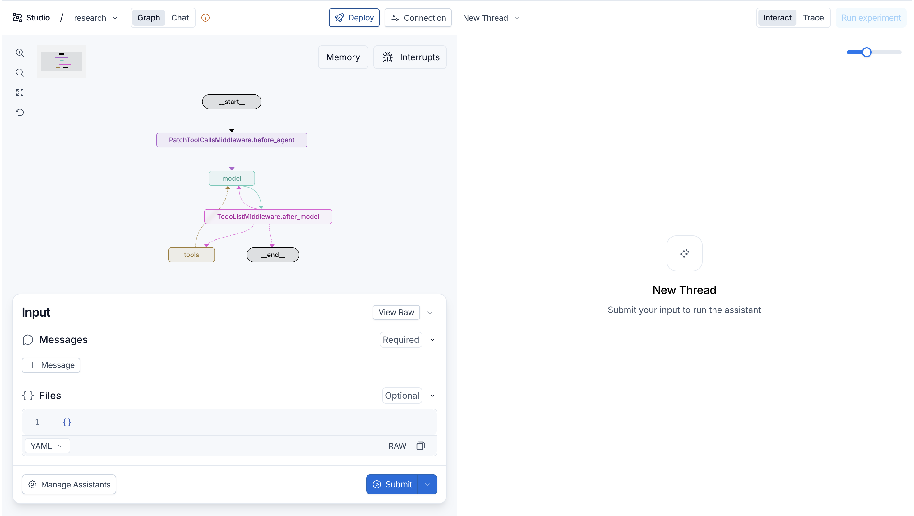
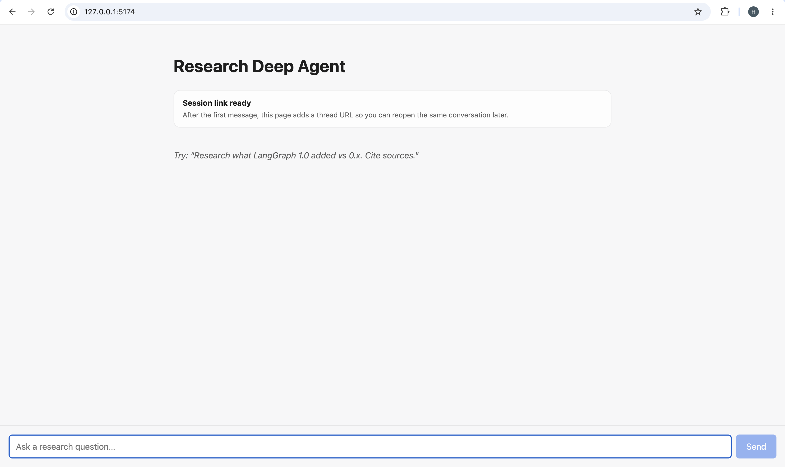

教程链接：[Pre01-AgentSeek-Create](https://datawhalechina.github.io/deepagents-in-action/chapters/pre01-agentseek-create/)

1. 操作系统 MacOS，利用 Homebrew 通过命令 `brew install uv` 安装 uv，而不是教程中的 `curl -LsSf https://astral.sh/uv/install.sh | sh`
2. 安装完成后要通过命令 `uv tool update-shell` 更新 shell 配置文件，之后重启终端，否则命令行没法使用 agentseek

## 完成结果

1. LangGraph Studio 本地 Agent 可视化调试界面（AgentSeek）- 后端服务 `127.0.0.1:2024`

> LangGraph Studio 是 LangGraph 提供的可视化开发与调试工具，可连接本地 LangGraph Server，用于查看 Agent 工作流（Graph）、执行状态、节点调用及调试交互。

2. 前端页面 `127.0.0.1:5174`

